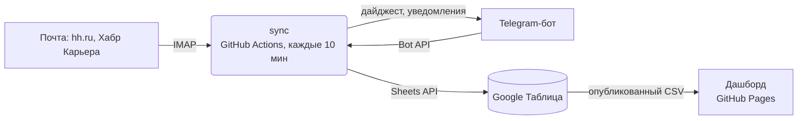

# Job Tracker

Автоматический трекер откликов на вакансии. Статусы откликов обновляются из писем hh.ru и Хабр Карьеры, отклики из Telegram-каналов и с сайтов компаний добавляются через бота. Данные хранятся в Google Таблице, аналитика воронки — на дашборде.

**Дашборд:** https://ruzilya123.github.io/jobs-tracker/

## Возможности

- **Почта → статусы.** Письма hh.ru и Хабр Карьеры (отклик отправлен, просмотр, приглашение, тестовое, оффер, отказ) распознаются и меняют статус отклика; новые отклики добавляются автоматически.
- **Telegram-бот.** Пересланный пост из канала или ссылка на вакансию → новая строка в таблице. Статус и вариант сопроводительного письма меняются кнопками.
- **Google Таблица.** Лист «Отклики» с выпадающим списком статусов и цветовой разметкой, лист «Аудит» с формулами воронки.
- **Дашборд.** Воронка и конверсии в сравнении с нормами, каналы, A/B-сравнение сопроводительных писем, активность по дням, отклики без ответа больше 10 дней. Обновление раз в минуту, светлая и тёмная темы.
- **Дайджест.** Ежедневная сводка в Telegram, по понедельникам — недельный аудит.

## Архитектура



**Стек:** TypeScript, Node.js 22, React 18, Vite, Vitest, Google Sheets API, Telegram Bot API, IMAP, GitHub Actions, GitHub Pages.

Без тяжёлых SDK: клиенты Google Sheets (авторизация сервисным аккаунтом через JWT) и Telegram Bot API написаны на `fetch`, графики дашборда — на SVG.

## Статусы

`Отправлено` → `Просмотрено` → `Приглашение` → `Интервью 1 этап` → `Тестовое задание` → `Интервью 2 этап` → `Оффер`, а также `Отказ`, `Без ответа (>10 дней)`, `Снял отклик`.

Автоматические изменения только продвигают отклик по воронке (или ставят отказ) и никогда не откатывают статус назад. Колонка «Макс. этап» сохраняет самый дальний этап — конверсии считаются корректно даже после отказа.

## Бот

Пересланный пост или ссылка добавляет отклик. Ручной формат: `ссылка | Компания | Вакансия | вариант письма`.

| Команда | |
|---|---|
| `/today` | откликов сегодня и прогресс к дневной цели |
| `/stats [7\|30\|all]` | аудит воронки за период |
| `/stale` | отклики без ответа больше 10 дней |
| `/last` | последние отклики |
| `/followup` | шаблон follow-up письма |
| `/dashboard` | ссылка на дашборд |

## Конфигурация

Локально — файл `.env` (шаблон в `.env.example`), в GitHub Actions — Secrets и Variables.

| Переменная | Где | |
|---|---|---|
| `SPREADSHEET_ID` | secret | ID Google Таблицы |
| `GOOGLE_SERVICE_ACCOUNT_JSON` / `_FILE` | secret | ключ сервисного аккаунта (JSON или путь к файлу) |
| `IMAP_HOST`, `IMAP_USER`, `IMAP_PASSWORD` | secret | почтовый ящик (пароль приложения) |
| `TELEGRAM_BOT_TOKEN`, `TELEGRAM_OWNER_ID` | secret | токен бота и ID владельца |
| `TELEGRAM_API_URL` | env | свой адрес Bot API (прокси), по умолчанию `api.telegram.org` |
| `SHEET_CSV_URL` | variable | опубликованный CSV листа «Отклики» для дашборда |
| `DASHBOARD_URL` | variable | ссылка на дашборд в сообщениях бота |
| `LETTER_VARIANTS` | variable | варианты сопроводительного письма, по умолчанию `real-time,legacy,общее` |
| `TZ_NAME`, `DIGEST_HOUR`, `AUTO_STALE`, `EMAIL_FIRST_RUN_DAYS` | env | часовой пояс, час дайджеста, автоотметка «без ответа», глубина первого чтения почты |

## Запуск

```bash
npm install
npm run check          # проверка подключений: Google, IMAP, Telegram
npm run setup          # создание и оформление листов таблицы
npm run sync           # один проход синхронизации
npm run dev            # бот в режиме long polling + почта каждые 10 минут
npm run email:check    # диагностика распознавания писем (без записи)
npm run digest         # отправить дайджест
```

Дашборд:

```bash
npm run dashboard:install
npm run dashboard:dev      # без VITE_SHEET_CSV_URL работает на демо-данных
npm run dashboard:build
```

## Деплой

- `.github/workflows/sync.yml` — синхронизация по расписанию (каждые 10 минут) и вручную.
- `.github/workflows/pages.yml` — сборка и публикация дашборда на GitHub Pages при изменениях в `dashboard/` и `core/`.

## Структура

```
core/               общая логика: статусы, каналы, даты, расчёт аудита
sync/src/
  sheets.ts         клиент Google Sheets API
  store.ts          работа с таблицей: загрузка, изменения, пакетная запись
  setup.ts          создание листов, валидация, условное форматирование, «Аудит»
  email/            IMAP и правила распознавания писем
  telegram/         бот: разбор сообщений, карточки, команды, дайджест
  jobs.ts, cli.ts   сценарии синхронизации и CLI
sync/test/          тесты
dashboard/          Vite + React + TypeScript
```

## Тесты

```bash
npm test
npm run typecheck
```

## Ограничения

- Письма распознаются правилами по формулировкам площадок (`sync/src/email/rules.ts`); при изменении текстов писем правила нужно обновить.
- В режиме GitHub Actions бот обрабатывает сообщения с задержкой до интервала расписания.
- Опубликованный CSV доступен по ссылке без авторизации.
