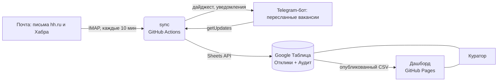

# Job Tracker — трекер откликов, который заполняется сам

Сервис ведёт таблицу откликов на вакансии без ручного ввода и считает недельный аудит воронки.

- **Письма hh.ru и Хабр Карьеры** (приглашение, отказ, просмотр, тестовое) → статус отклика в таблице меняется сам.
- **Telegram-бот**: пересылаешь пост с вакансией из канала или кидаешь ссылку → строка в таблице. Статус и вариант сопроводительного письма — кнопками.
- **Google Таблица** — единый источник данных: её видит куратор, там же лист «Аудит» с формулами.
- **Дашборд** (React + TypeScript) — воронка, конверсии в сравнении с нормами, каналы, A/B-сравнение писем, активность по дням, зависшие отклики. Обновляется раз в минуту.
- **Утренний дайджест** в Telegram: сколько откликов вчера, цель на сегодня, кому пора написать follow-up. По понедельникам — полный недельный аудит.

Всё работает бесплатно: GitHub Actions (расписание), GitHub Pages (дашборд), Google Sheets API, Telegram Bot API.



## Структура

```
core/        общая логика: статусы, каналы, даты, аудит воронки (используют и sync, и дашборд)
sync/src/    синхронизация
  sheets.ts      клиент Google Sheets API на fetch (без тяжёлого googleapis)
  store.ts       таблица в памяти: загрузка, изменения, запись одной пачкой
  setup.ts       создание листов, выпадающие списки статусов, цвета, лист «Аудит»
  email/         IMAP + правила распознавания писем
  telegram/      бот: разбор пересланных постов, карточки с кнопками, команды, дайджест
  jobs.ts, cli.ts
sync/test/   тесты (vitest)
dashboard/   Vite + React + TS, без библиотек графиков — SVG руками
.github/workflows/  sync.yml (расписание) и pages.yml (деплой дашборда)
```

## Настройка (≈30 минут, один раз)

### 1. Google Таблица и сервисный аккаунт

1. Создайте пустую Google Таблицу. ID — это часть ссылки между `/d/` и `/edit`.
2. Откройте [console.cloud.google.com](https://console.cloud.google.com) → создайте проект → **APIs & Services → Library** → включите **Google Sheets API**.
3. **IAM & Admin → Service Accounts → Create service account** (роли не нужны) → в аккаунте **Keys → Add key → JSON**. Скачается файл — положите его в корень проекта как `google-key.json` (он в `.gitignore`).
4. В таблице нажмите **«Поделиться»** и добавьте email сервисного аккаунта (`…@….iam.gserviceaccount.com`) с правами **Редактор**.

### 2. Почта (Gmail)

1. Включите двухэтапную аутентификацию в аккаунте Google.
2. [myaccount.google.com/apppasswords](https://myaccount.google.com/apppasswords) → создайте **пароль приложения** → это `IMAP_PASSWORD`.
3. Письма только читаются: ничего не помечается прочитанным и не удаляется.

Для Яндекс Почты: `IMAP_HOST=imap.yandex.ru` + пароль приложения Яндекса.

### 3. Telegram-бот

1. В [@BotFather](https://t.me/BotFather): `/newbot` → получите токен → `TELEGRAM_BOT_TOKEN`.
2. Напишите своему боту любое сообщение, запустите `npm run sync` — бот ответит вашим ID → `TELEGRAM_OWNER_ID`. Остальным людям бот не отвечает.

### 4. Запуск на своём компьютере

```bash
npm install
cp .env.example .env        # заполнить
npm run check               # проверит подключения к Google, почте и Telegram
npm run setup               # создаст листы «Отклики», «Аудит» и служебный _state
npm run email:check         # покажет, как распознаются последние письма (ничего не пишет)
npm run sync                # один проход
npm run dev                 # бот в реальном времени, пока открыт терминал
```

Дашборд локально:

```bash
npm run dashboard:install
npm run dashboard:dev       # без VITE_SHEET_CSV_URL — на демо-данных
```

### 5. Автоматический режим на GitHub (бесплатно)

1. Создайте **публичный** репозиторий и запушьте проект (в публичном репо минуты Actions не ограничены; ключей в коде нет — они в Secrets).
2. **Settings → Secrets and variables → Actions → Secrets**:
   `GOOGLE_SERVICE_ACCOUNT_JSON` (содержимое google-key.json целиком), `SPREADSHEET_ID`, `IMAP_USER`, `IMAP_PASSWORD`, `TELEGRAM_BOT_TOKEN`, `TELEGRAM_OWNER_ID`.
3. **Variables**: `DASHBOARD_URL`, при желании `LETTER_VARIANTS`.
4. Опубликуйте лист для дашборда: в таблице **Файл → Поделиться → Опубликовать в интернете → лист «Отклики» → CSV** → ссылку положите в variable `SHEET_CSV_URL`.
5. **Settings → Pages → Source: GitHub Actions**. Дашборд появится на `https://<логин>.github.io/job-tracker/`.
6. Свой домен (например `jobs.ruzya.ru`): в DNS у регистратора CNAME `jobs` → `<логин>.github.io`, затем **Settings → Pages → Custom domain**.

## Как пользоваться

- **Откликнулась на hh / Хабре** — ничего делать не нужно: письмо-подтверждение или первое письмо от работодателя создаст строку, следующие письма будут двигать статус.
- **Откликнулась из Telegram-канала / на сайте компании** — перешлите пост боту или пришлите ссылку. Формат вручную: `ссылка | Компания | Вакансия | письмо`.
- **A/B писем** — под карточкой отклика выберите вариант письма (`✉ real-time`, `✉ legacy`…). Через пару недель на дашборде видно, какой «крючок» чаще приводит к приглашению.
- Команды бота: `/today`, `/stats` (`/stats 30`, `/stats all`), `/stale`, `/last`, `/followup`, `/dashboard`.
- Таблицу можно править руками: сортировать, менять статусы из выпадающего списка, добавлять строки — синхронизация это учитывает (строки ищутся по ID, новым строкам ID выдаётся сам).

## Что важно знать

- **Telegram API из России часто недоступен или сильно тормозит.** Если `npm run check` пишет, что Telegram не отвечает: запускайте локально с VPN, задайте `TELEGRAM_API_URL` (свой прокси к Bot API) или держите бота только на GitHub Actions — серверы GitHub за границей, там Telegram работает. Почта и таблица при этом синхронизируются в любом случае.

- **Распознавание писем** сделано правилами по типичным формулировкам hh.ru и Хабра (`sync/src/email/rules.ts`). Площадки иногда меняют тексты — прогоните `npm run email:check` и при необходимости поправьте регулярки; тесты в `sync/test/email.test.ts`.
- **«Просмотрено»** hh присылает письмом не всегда — этот статус может не обновиться сам.
- **Автоматика никогда не откатывает статус назад**: письмо «резюме просмотрено» не перезапишет назначенное интервью. Отказ — применяется всегда.
- **Бот в режиме GitHub Actions** отвечает с задержкой до ~10 минут (расписание GitHub иногда опаздывает ещё сильнее). Нужна мгновенная реакция — `npm run dev` на своём компьютере.
- **Опубликованный CSV доступен всем, у кого есть ссылка.** Не пишите в «Заметки» ничего личного.
- GitHub отключает расписание в репозитории без коммитов 60 дней — достаточно раз в месяц что-нибудь закоммитить или нажать «Enable workflow».

## Тесты

```bash
npm test          # 27 тестов: статусы, аудит, разбор писем и сообщений бота, работа с таблицей
npm run typecheck
```
